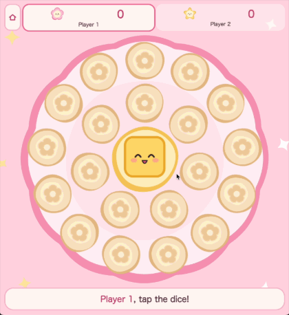
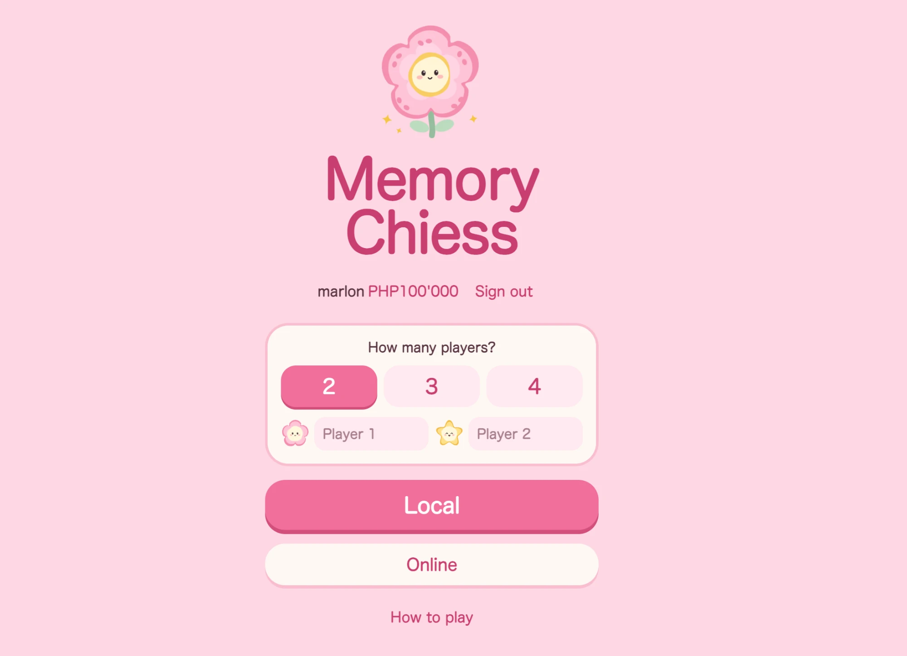
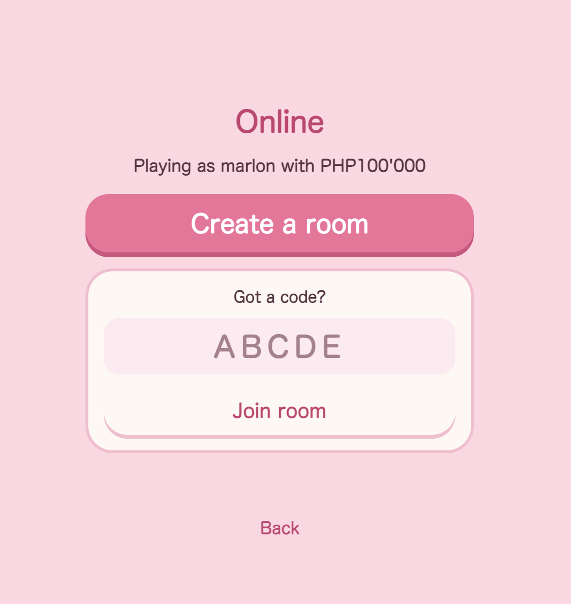

# Memory Chiess

Fun color memory game for 2 to 4 players that you can play with friends at the table or long distance.

[](https://marlonsteiner.github.io/memory-chiess/)

<p align="center">
  
</p>

<p align="center">
  
  
</p>

Play on one iPhone or iPad passed around the table, or online from separate phones. To install it, open the link in Safari, tap Share, then Add to Home Screen. It works offline after the first visit.

## Rules

1. Roll the dice: five colors, and a sixth black side that ends your turn.
2. Tap one hidden chip on the round board. If it matches the dice, you keep it for one point and roll again.
3. If it doesn't match, it hides again in the same spot and your turn ends.
4. When all 20 chips are gone, the most points wins.

A color with no chips left is rolled again.

## Online

Tap Online, create a room and share the 5-letter code or invite link. Up to 4 players join from their own phones, and the host starts the game. If a phone locks or the app closes, tap Rejoin room on the menu.

Online play needs an account with a username and password. New players get PHP100'000 of play money. The host picks the bet in the lobby, from PHP1'000 up in steps of PHP500, and never above what the poorest player has. Winners share all the bets. A game that isn't finished costs nobody anything.

Phones connect through HiveMQ's free public MQTT relay, so there is no server to run. Room data is encrypted with a key made from the room code, and rooms disappear from the relay after a day. The relay has no uptime guarantee; swapping it means changing `net.js`.

## Accounts server

`server/` is a small Vercel function that keeps accounts and balances in a private Vercel Blob store. Passwords are stored as scrypt hashes. The result of a game is reported by the players' phones, so a player could fake a win against the people in their own game, but nobody can be charged for a game they didn't join.

## iPhone app

`app/` wraps the same web files in an iOS app with Capacitor, so the website and the app share one codebase. Edit the web files at the top level, then:

```bash
cd app && npm install && ./build-sim.sh
```

That copies the web files into the app, builds it and opens it in the iPhone Simulator. `npm run open` opens the project in Xcode. Updates to the website go live on push; the App Store version only changes when a new build is submitted.

## Run locally

```bash
python3 -m http.server 4180
```

Plain HTML, CSS and JavaScript, no build step. All the art is drawn as SVG in `art.js`.
